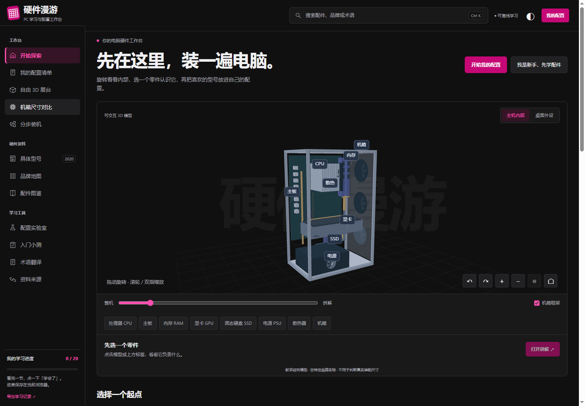

# 硬件漫游 · Hardware Roam

面向电脑小白的中文电脑硬件与外设交互学习网站。以 BuildCores 风格的工作台组织界面，保留中文教学和离线使用方式。

**在线访问：[打开硬件漫游](https://fuzzylogic112.github.io/hardware-roam/)**



## 可以做什么

- 认识 20 类硬件和设备，浏览 158 个品牌索引及中文术语。
- 在 2020 条型号样本中按品类、厂商和规格筛选，最多对比三个同类产品。
- 旋转、拆解教学主机模型，切换桌面外设场景，跟随 9 步装机教学。
- 比较机箱的同比例外形尺寸、包围盒体积与桌面占地。
- 为 17 类设备选择型号、自填报价，查看 13 项基础兼容观察，保存和导入导出配置。
- 在手机上使用折叠导航和筛选，切换深浅主题；学习进度保存在当前浏览器。

## 本地打开与更新

直接打开 `docs/index.html`，这个单文件包含运行所需的脚本、样式、数据和图片。

修改源码后，需要 Python 3，运行：

```sh
python build_pages.py
```

把源码和更新后的 `docs/` 提交到 `main`。GitHub Pages 从 `main` 分支的 `/docs` 发布。

开发入口是根目录 `index.html`；页面以哈希路由导航，支持 GitHub Pages 的仓库子路径。

## 数据与素材来源

- 20 条入门型号样本由本项目独立整理，来源链接保留在页面中。
- 2000 条社区样本改编自 [BuildCores OpenDB](https://github.com/buildcores/buildcores-open-db)，固定源版本 `c6e319a47cbca29574e951d744e209c3de14f7d7`，采用 [CC BY-NC-SA 4.0](https://creativecommons.org/licenses/by-nc-sa/4.0/)。本项目用于非商业学习。
- 改编包括抽样、字段筛选、中文标签、插槽/板型字符串规范与外形体积计算。数据、许可和署名说明见 [`third-party/buildcores/`](third-party/buildcores/)。分发改编数据需遵守署名、非商业和相同方式共享条件。
- 品牌商标与产品图片的权利属于各自权利人，来源见 [`assets/manifest.json`](assets/manifest.json)。数据许可不覆盖第三方图片和商标。
- 教学模型和尺寸几何由本项目绘制，不是品牌实物模型。未复制 BuildCores 网站源码或品牌 3D 素材。

重新生成固定版本的数据样本：

```sh
python import_buildcores.py --download
python build_pages.py
```

首次会下载约 50MB 的官方仓库快照。日常构建不需要下载。

## 内容边界

社区数据可能有缺失或错误；未收录的参数保留为待核对。本页不提供实时价格、库存、性能排名、FPS 预测或完整装配验证。型号和基础规则不能代替厂商说明书、BIOS 支持列表与实际装配检查。

页面不含追踪脚本和账户系统。在线版与原本地文件的浏览器存储相互独立，配置可以通过 JSON 文件迁移。
